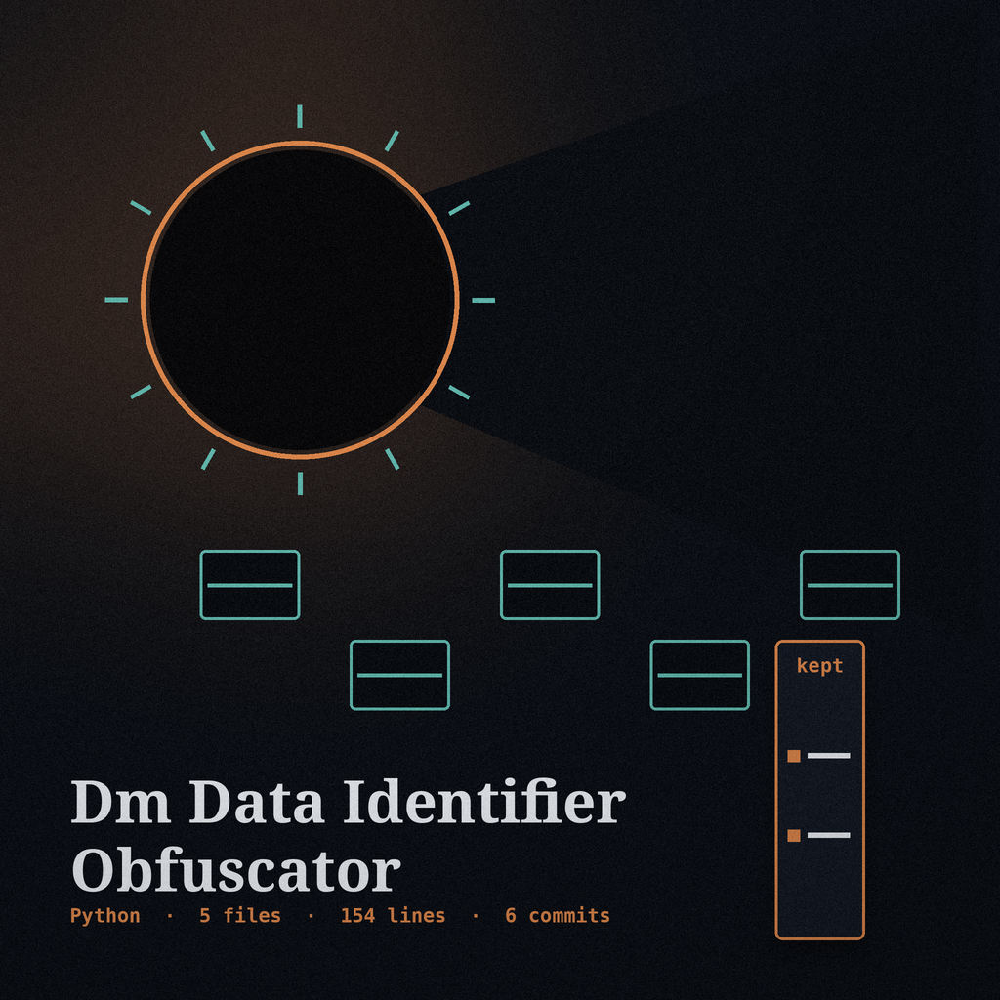

# dm-data-identifier-obfuscator

Index entry, author's name leading: the name above is set in Courier Prime in iron gall ink, as an archive index entry, with a small date stamp picture at the left of the title block and the carbon copy page in miniature beside this first heading only, the little carbon page serving as the section marker throughout this page.

# dm-data-identifier-obfuscator
Replaces sensitive data identifiers (e.g., SSN patterns) with randomly generated, valid-looking identifiers matched by a basic SSN format pattern. There is no checksum step; matching is by shape alone. - Focused on Tools designed to generate or mask sensitive data with realistic-looking but meaningless values

> Index memorandum: detection operates on contour exclusively, with no checksum stage.

## Install
`git clone https://github.com/ShadowGuard-AI/dm-data-identifier-obfuscator`

> Index memorandum: the README fetching line fuses the organisation name minus its hyphen.

## Usage
`python3 main.py input_file output_file [options]`

## Parameters
- `-h`: Show help message and exit
- `input_file`: The input file to process (positional).
- `output_file`: The output file to write to (positional).
- `--identifier_type`: The type of identifier to obfuscate (default: ssn). Only ssn is supported.

## Behavior notes
- The output file may not be the input file. If the resolved output path is the input file, by the same spelling, a `./` alias, or a symlink, the run refuses at exit 1 before anything is written and the input is left untouched.
- The run counts the identifiers it replaces. If a file holds no matching identifier, including an empty file, the run prints "No identifiers found.", exits 1, writes no output file, and does not print the "Data obfuscated" line.

> Index memorandum: the outgoing document may not resolve onto the incoming document.

> Index memorandum: an invocation discovering no identifier departs at exit 1 and composes nothing. It prints "No identifiers found."

## License
This project is released under the MIT License. See the [LICENSE](LICENSE) file for details.

## Sheets gathered at the desk

The chief button of this re-skin reads Obfuscate the Identifiers. Its identifier variety field label reads Identifier Type. Its safeguard heading reads The Output Is Never the Input. Its empty outcome heading reads A File With No Match Writes Nothing. It ends with the desk at rest: typewriter muted, the final copy creased into its unadorned cover, and the original identifiers absent from every page in the chamber. Whatever travels now is the substitute, struck fresh, and the contour is everything it retained.
